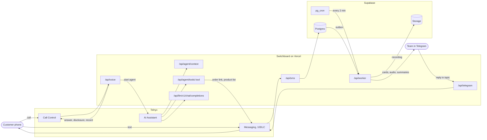

# Switchboard

The phone line for [Akme](https://akmeusa.com), my moving supply company in Springfield, California. An AI agent answers every call, prices what the caller asks about, takes the order and texts a link to confirm it. Texts to the same number get answered. Every call and text lands in a Telegram group, one topic per customer, where a person can read the summary, play the recording, reply, or approve what the agent proposed.

Live on real customer calls since July 2026.

## What a call sounds like

Every agent line below is the exact string the code produces for this order.

```text
Robin   Hi, you've reached Acme U S A. This is Robin, I'm an automated
        assistant, and this call is recorded. How can I help you today?
Caller  How much is the tan tape and the big stretch film?
Robin   The tan hot melt tape is twenty-four dollars and forty-two cents
        a case, and the eighteen inch stretch film is forty-two dollars and ninety cents a case.
Caller  Ten cases of tape and four of the film.
Robin   Ten cases of tan hot melt tape is two hundred forty-four dollars and twenty cents, and four cases of eighteen inch stretch film is one hundred seventy-one dollars and sixty cents. That comes out to about four hundred fifteen dollars and eighty cents. Would you like me to send you
        the confirmation link?
Caller  Yes please.
SMS     Akme USA: your order is ready to confirm here: https://... The link
        works for 48 hours. Questions? Call (555) 555-0124.
```

A few minutes after the caller hangs up, the recording, a transcript and a summary land in their Telegram topic.

## How it works



**Calls.** `/api/voice` answers and plays the recording disclosure in the agent's own voice. The Telnyx AI Assistant boots behind that audio so the caller never waits on it, the dual-channel recording starts when the disclosure ends, and the assistant takes the call with the caller's context attached: whether they are a known customer and what they last ordered. The agent has nine tools: price products, price an order, text the confirmation link, text the product list, look up an invoice, check an order, take a message, offer a person, and ring the team. If nobody picks up, the caller gets voicemail.

**Texts.** `/api/sms` files every message, posts it to the customer's topic, and asks Akme's order desk what to answer. With no desk configured, the text waits in Telegram for a person, and only HELP gets an automatic answer. STOP, START and HELP are carrier commands and are handled as such, with opt-outs kept in a ledger. A text asking to change an order becomes a card with an Apply button, never a change.

**Telegram.** Each customer gets one forum topic, titled with their name and number. Type in the topic and it goes out as a text to that customer. Buttons on the cards send a drafted reply, mark a quote handled, ask for a callback, or apply an order change.

**After the call.** pg_cron calls `/api/worker` every 2 minutes. The worker downloads the recording into private storage, transcribes both channels with AssemblyAI, writes a structured summary, and posts the card with the audio.

## Decisions worth reading

- **Two seconds per webhook.** Telnyx times webhooks out at 2 seconds and retries anything that is not a 2xx. The request path only verifies the Ed25519 signature and returns 200. Call commands run after the response, each event id is claimed once so a retry never acts twice, and recordings, transcripts and summaries wait for the worker. The failure mode is a late card, never a dropped call.
- **Consent before the recorder.** California requires every party's consent to record. The disclosure plays first and `record_start` waits for it to finish.
- **A model gateway built around caching.** The agent's prompt is resent on every turn, so caching decides the bill. The assistant talks to `/api/llm/v1/chat/completions`, which runs a cached model (96 to 97 percent of prompt tokens cached, measured), strips reasoning tags before they reach text to speech, and falls back to Claude Haiku 4.5 if the primary errors or misses a 6 second deadline. Measured on a 107 second call on 2026-08-15: $0.112 to $0.118 in model cost, against $0.179 uncached.
- **The agent never does arithmetic.** `price_order` totals the order in integer cents and returns the sentence to say. It also returns a single-use quote token that lives 10 minutes, and `send_order_link` has to spend it, so a link for an order the caller never heard cannot be sent. Short stock ends the turn with a question about quantity, not a smaller order.
- **Money moves on a human tap.** The phone path never touches the books: stock comes from Akme over a signed, read-only call, and the optional QuickBooks mirror ships turned off. Order changes by text become proposals that a person applies with a tap.
- **One door for outbound texts.** The agent, the auto-reply, a button and a typed reply all go through `sendSms`. It fails closed: an empty allowlist texts nobody. An opt-out beats every caller, including a human. It records before it sends, and a carrier refusal posts an alarm card instead of a log line.
- **Secrets are split by door.** The agent's tools, the Telegram webhook, the model gateway, the worker and each call into Akme carry their own shared secret, so one leak never opens the rest. Inbound Telnyx webhooks are checked against an Ed25519 signature. Row level security is on for every table with zero policies, so only the service role reads anything.
- **The prompt has its own harness.** `pnpm rehearse` plays scripted callers against the live model and scores the transcript with mechanical checks, for cents a run. Unit tests cannot hear a prompt regress; this can.

## Stack

| Layer | Choice |
| --- | --- |
| App | Next.js 16 route handlers on Vercel, TypeScript |
| Voice and SMS | Telnyx Call Control, AI Assistants, Messaging on a registered 10DLC campaign |
| Speech to text | Deepgram Flux live on the call, AssemblyAI Universal-3.5 Pro after it |
| Models | Telnyx hosted inference and NEAR AI Cloud, Claude Haiku 4.5 as the fallback |
| Data | Supabase Postgres, Storage for recordings, pg_cron for the worker |
| Ops desk | Telegram Bot API, forum topics in one supergroup |

## Run it

Needs Node 24 (the scripts run TypeScript directly) and pnpm.

```bash
pnpm install
cp .env.example .env.local      # every variable is documented in place
pnpm preflight                  # makes a real call to every service, names what is broken
pnpm dev
```

Then wire the outside world to it:

1. **Supabase.** Switchboard runs inside Akme's database: it reads Akme's customers, orders and CRM tables, so it needs Akme's schema first, plus the `pg_cron` and `pg_net` extensions. Then apply `supabase/migrations/` in order, create a private Storage bucket named `recordings`, and add the people who should ring when a caller asks for one to the `responders` table. Schedule the worker with `select public.schedule_worker('<WORKER_SECRET>', 'https://<your-host>');`.
2. **A public URL.** Point a tunnel at port 3000 (or deploy) and set `PUBLIC_BASE_URL` to it.
3. **Telnyx.** Send Call Control webhooks to `/api/voice` and messaging webhooks to `/api/sms`. Then `pnpm opener:render` renders the disclosure audio and `pnpm assistant:sync` creates the AI assistant and reads every field back.
4. **Telegram.** Make a supergroup with topics on, add the bot as an admin, and register `/api/telegram` as its webhook with `TELEGRAM_WEBHOOK_SECRET`.

Texts only leave for numbers on `SMS_ALLOWLIST`. Put your own number there until you mean to reach customers.

## Test it

```bash
pnpm vitest run                       # unit tests, no network
npx tsc --noEmit -p tsconfig.json     # typecheck
pnpm lint
pnpm rehearse                         # with pnpm dev running: scripted callers, cents a run
```

## Where things live

| Path | What it does |
| --- | --- |
| `app/api/voice` | Call Control webhook: answer, disclosure, recording, agent start, ring the team |
| `app/api/agent/context` | Caller context for the agent, answered before hello |
| `app/api/agent/tools/[tool]` | The agent's nine tools |
| `app/api/llm/v1/chat/completions` | The model gateway: caching, tag stripping, fallback |
| `app/api/sms` | Inbound texts and delivery receipts |
| `app/api/relay/sms` | Template-only texts on Akme's behalf (codes, order links) |
| `app/api/telegram` | Replies typed in topics and card buttons |
| `app/api/worker` | Recordings, transcripts, summaries, the Telegram outbox |
| `lib/agent/brief.ts` | Everything the agent knows and how it should sound |
| `lib/orders` | Pricing in integer cents, quote tokens, order drafts |
| `scripts/` | `preflight`, `rehearse`, `assistant:sync`, `opener:render`, `repoint` |

## Further reading

- [`docs/BEHAVIOR.md`](docs/BEHAVIOR.md): the contract for what the agent may say, and where a person has to step in.
- [`docs/specs/2026-08-27-phone-orders-design.md`](docs/specs/2026-08-27-phone-orders-design.md): the design for pricing and taking orders on the phone.
- [`docs/research/`](docs/research): the vendor research behind Telnyx, the speech models and Telegram.
- [`AGENTS.md`](AGENTS.md): what the Telnyx AI Assistants API does that its docs do not say.

## License

[FSL-1.1-MIT](LICENSE). Read it, run it, change it. Each version becomes MIT two years after release.
